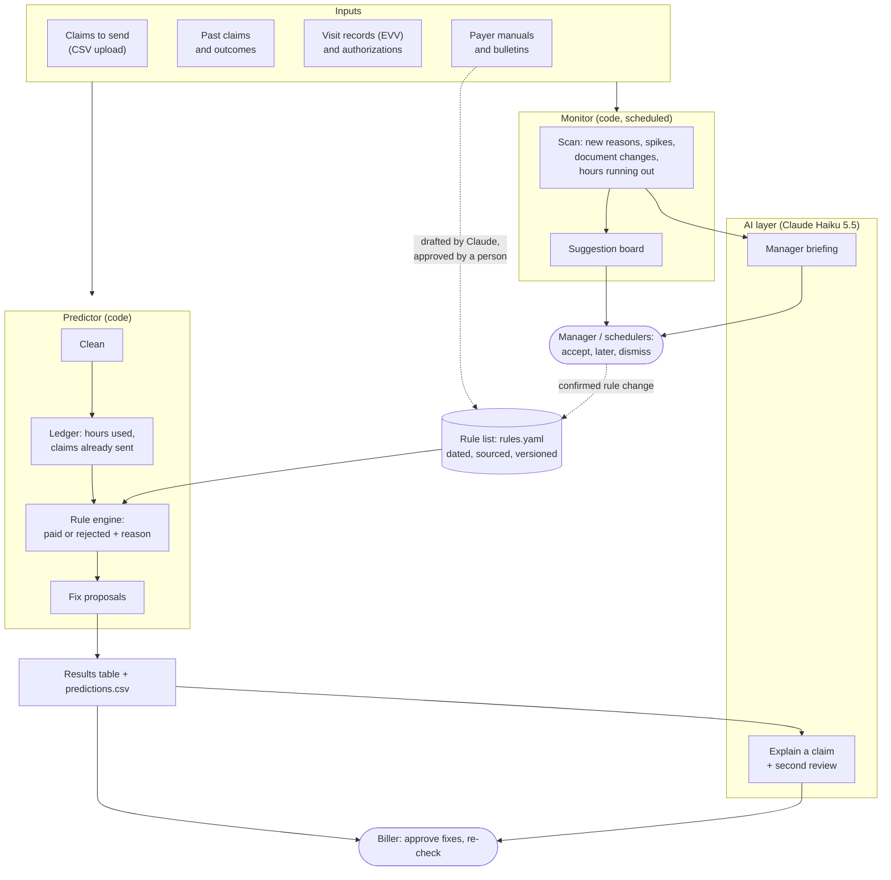
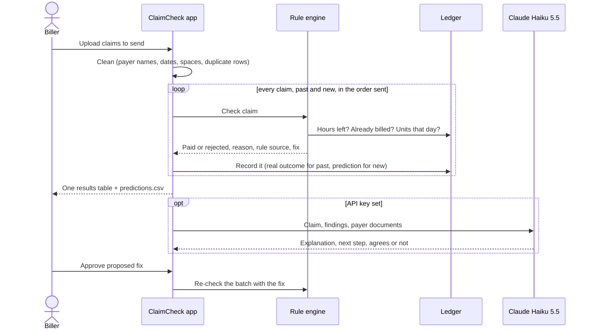
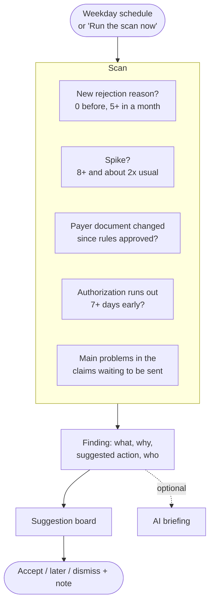
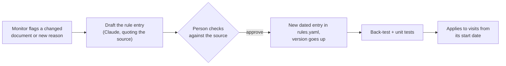

# ClaimCheck: system design

[1. Architecture](#1-architecture) · [2. Component workflows](#2-component-workflows) · [3. Functionality checklist](#3-functionality-checklist)

## 1. Architecture

Three components share one rule list and one record of claims. **Rules decide, AI explains, a person approves.**

| Component | What it is | Why |
|---|---|---|
| **Predictor** | Plain Python reading `rules.yaml` | Billing moves money and is audited: the same claim must always get the same answer, traceable to a rule |
| **Monitor** | Counts and fixed thresholds, run on a schedule | Catches rule changes and trends no one sees claim by claim |
| **AI layer** | Claude Haiku 5.5, payer documents in a cached prompt, fixed output structure | Does what code is bad at: plain-English explanation and re-reading the documents as a second reviewer. Never changes a result |
| **Rule list** | Data, not code: each rule has a source and start/end dates | A payer change is a new dated entry, not a code change; old rules stay for older visits |

Nothing is trained. Rules were drafted with Claude from the payer documents; the rule order and Summit's undocumented rule were
learned from past outcomes by counting.

## 2. Component workflows

### Predictor: checking a batch

Past and new claims overlap in time and use the same authorizations, so they are replayed together **in the order sent** through one
ledger: each claim is checked against everything sent before it, including earlier claims in the same batch.

| Check | Rejection | Who can fix it |
|---|---|---|
| Verified visit record exists | D01 | another team (care coordinator) |
| Units within the visit time, using the payer's rounding | D09 | fix here (units from EVV) |
| Authorization present, matching, with hours left | D07, D08, D02 | fix here if a matching one exists, else authorization team |
| Sent within the deadline in force on the visit date | D03 | can't be fixed |
| Not already billed (else: send as corrected claim) | D05 | fix here, or can't be fixed |
| Daily unit limit (Harbor) | D06 | another team (scheduling) |
| Billing tag (Harbor), contract rule (Summit whole hours) | D04, D10 | fix here |

When several rules break, the payer reports one: `D01 → D10 → D09 → D08 → D07 → D04 → D05 → D06 → D02 → D03` (learned from history).
**Fix proposals** apply one fix, re-check, and repeat (up to 4 rounds); values only come from existing records; nothing changes until approved.

### Monitor: routine scan

On the data it finds Summit's unannounced July rule, four spikes in rejection reasons, and 75 authorizations running out early.

### AI layer

| Call | Input | Output | Guardrails |
|---|---|---|---|
| Explain a claim | Claim, engine findings, all payer documents (cached) | Summary, next step, agrees yes/no, reviewer note | Fixed output structure; disagreement goes to a person; only flagged claims; answers saved to disk |
| Manager briefing | Monitor findings only | Short plain-English briefing | Told to use only the facts given and flag uncertainty |

### Rule change

A new kind of rule (like Summit's whole hours) needs a small code change; a new payer is a new section in `rules.yaml`, run in
shadow mode until its own outcomes confirm the rules.

## 3. Functionality checklist

✅ done · 🟡 partly · 🔑 built, not yet run (needs API key) · 📐 design only

| Area | Functionality | Status | Extent / evidence |
|---|---|---|---|
| Predictor | Batch in, one results table out | ✅ | Check claims tab, `predict.py`; 546 claims |
| | Clean messy exports | ✅ | `load.py`; each change shown per claim |
| | Dated, sourced, versioned rule list | ✅ | `rules.yaml`; Payer rules tab |
| | All documented payer rules | ✅ | `engine.py`; 13 unit tests |
| | Undocumented Summit rule | 🟡 | Inferred from history, marked unconfirmed |
| | Claim dependencies (hours used, duplicates, daily limit) | ✅ | Shared timeline ledger; fixed all 10 D02 misses |
| | Claim groups in a database | 🟡 | In-memory ledger rebuilt each run |
| | Fixes split by who acts | ✅ | 48 fix here / 62 other team / 59 can't fix |
| | Repeated fix proposals, no invented data | ✅ | `propose_fix`; unit tests |
| | Person approves, then re-check | ✅ | Approve button; approvals last for the session |
| | Back-test on past outcomes | ✅ | 98.4% pay/reject, 99.9% precision |
| | Time-split test | 📐 | Not done (overfitting caveat) |
| | Plain-language interface | ✅ | Reasons in words, glossary sidebar |
| AI | Claim explanation + second review | 🔑 | `explain.py`, *Explain this claim* |
| | Manager briefing | 🔑 | *Write a briefing with AI*, `monitor_scan.py --brief` |
| | Cost control | ✅ | Haiku, cached documents, saved answers |
| Monitor | Trend graphs with explanations | ✅ | One graph viewer, notes per graph |
| | Rule change from outcomes (new reason, spikes) | ✅ | Finds Summit July rule |
| | Changed payer documents | 🟡 | Local copies vs snapshot; no web fetching |
| | Scheduled scan / scan on demand | 🟡 / ✅ | `monitor_scan.py` ready, no schedule set; button works |
| | Scan summary + suggestion board | ✅ | Accept / later / dismiss + notes, saved |
| | Authorization burn-rate alerts | ✅ | 75 alerts; list for schedulers |
| | News board routed by role | 🟡 | Cards name who acts; no per-role views |
| | Watch payer websites | 📐 | Design only |
| | Claude drafts rule changes | 📐 | Design only; by hand today |
| Other | New payer setup from its manual | 📐 | Unknown payers are flagged, never guessed |
| | Writing assistant (claims from verified visits) | 📐 | Design only |
| | Autofix agent with tools | 📐 | Design only |
